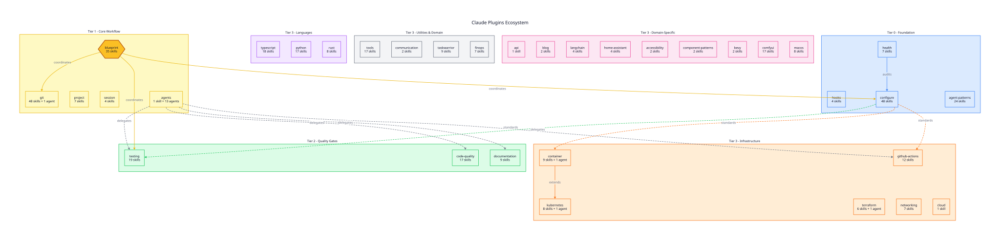
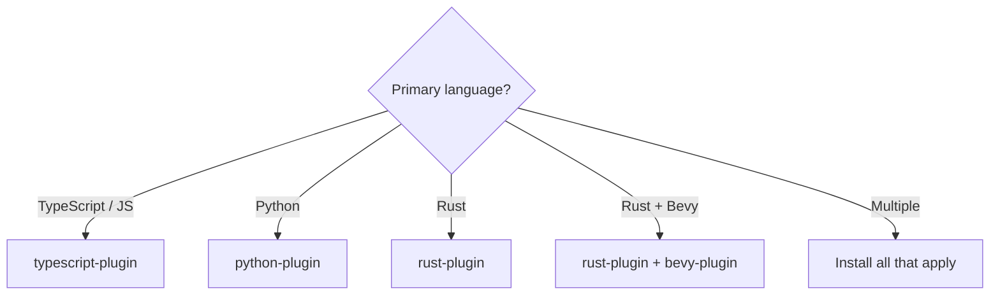
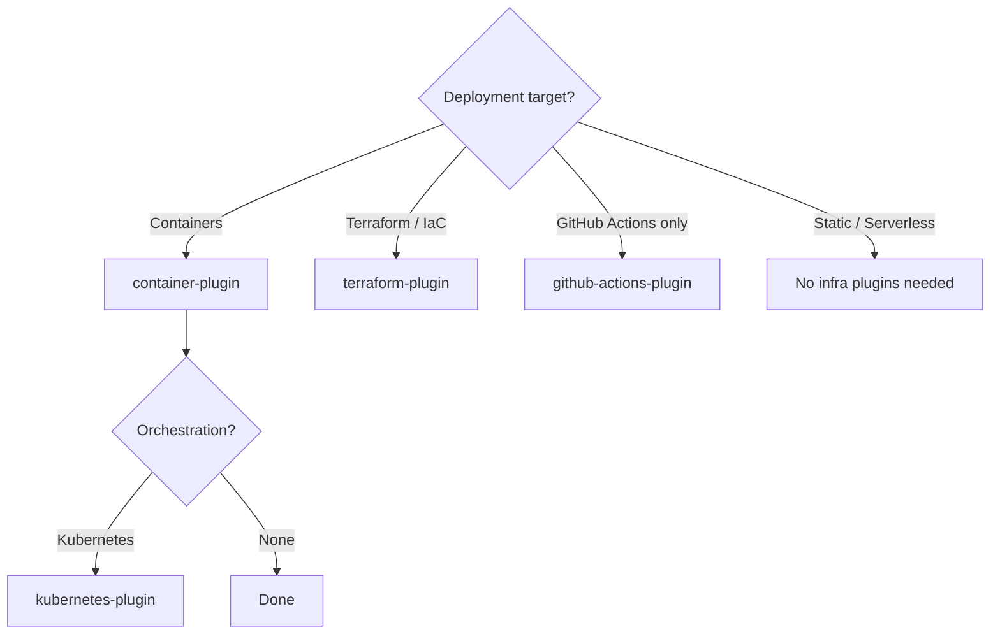
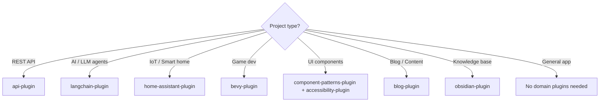

# Plugin Navigation Map

Navigation guide for 47 plugins and 380+ skills. Start here.

## Quick Start

| Intent | Commands | What happens |
|--------|----------|--------------|
| Diagnose setup | `/health:check` | Scans config and (by default) recommends plugins for your stack |
| New project | `/project:init` then `/blueprint:init` | Scaffolds project, then bootstraps `docs/blueprint/` once (manifest, PRD/ADR/PRP dirs) |
| Resume work | `/blueprint:execute` | Analyzes repo state, picks the one next action, runs it, exits |

`/blueprint:execute` is the interactive router: each run detects the single most relevant next blueprint action (upgrade, derive docs, regenerate rules, run a ready PRP, a work order, or a tracked task), runs that one action, and exits. Run it again for the next step. Its non-interactive counterpart is `/blueprint:autopilot`, which quietly runs due maintenance tasks at autonomy level 2+.

## Setup Sequence

Install in tier order. Each tier builds on the previous.

### Tier 0 - Foundation

Install these first. They configure the environment other plugins rely on.

| Plugin | Skills | Purpose |
|--------|--------|---------|
| health-plugin | 7 | Diagnose config issues, audit plugin selection |
| hooks-plugin | 4 | Enforce best practices via lifecycle hooks |
| configure-plugin | 48 | Infrastructure standards (CI, linting, testing, Docker, repo onboarding) |
| agent-patterns-plugin | 24 | Agent orchestration, MCP management, delegation |

### Tier 1 - Core Workflow

The development loop: plan, code, commit, ship.

| Plugin | Skills | Purpose |
|--------|--------|---------|
| blueprint-plugin | 35 | PRD/ADR/PRP/TRP methodology, `/blueprint:execute` auto-pilot, ambient autonomy levels (`/blueprint:autopilot`, `/blueprint:autonomy-level3`), monorepo portfolio tracking, story-audit/reconcile |
| git-plugin | 48 + 1 agent | Commits, branches, PRs, issues, forks, worktrees, release-please, merge hazards, issue scoping, upstream-fix and repo-deletion checks |
| project-plugin | 7 | Project init, modernization, maintenance |
| session-plugin | 4 | Session bookends: spinup briefing, wrap capture, end orchestrator, distill |
| agents-plugin | 1 + 13 agents | Task delegation to specialized agents |

### Tier 2 - Quality Gates

Automated quality enforcement.

| Plugin | Skills | Purpose |
|--------|--------|---------|
| testing-plugin | 19 | Test execution, TDD, Vitest, Playwright, Playwright CLI, mutation testing, tripwire tests, benchmark controls |
| code-quality-plugin | 17 | Review, refactoring, linting, ast-grep, debugging, silent degradation, dead code, dep audit, test quality, complexity, bulk-sweep classification, scaffold back-port, licence position |
| software-design-plugin | 6 | Deep modules, design by contract, GoF pattern selection, legacy seams, design by pseudocode |
| documentation-plugin | 9 | API docs, README generation, LaTeX PDFs, single-source linking, machine-fact verification, public-export sanitization, WebFetch fallbacks |
| evaluate-plugin | 7 + 3 agents | Skill evaluation, benchmarking, quality improvement |

### Tier 3+ - Pick What Applies

See [decision trees](#pick-your-stack) and [conditional plugins](#conditional-plugins) below.

## Plugin Relationship Diagram

> Render locally: `d2 -l elk docs/diagrams/plugin-relationships.d2 docs/diagrams/plugin-relationships.svg`

## Pick Your Stack

### Language

### Infrastructure

### Domain

## Project Presets

Pre-assembled plugin lists for common project types. Foundation + Core + Quality are always included.

### Python Web API

| Tier | Plugins |
|------|---------|
| Foundation | health, hooks, configure, agent-patterns |
| Core | blueprint, git, project, agents |
| Quality | testing, code-quality, documentation |
| Stack | python-plugin, container-plugin, github-actions-plugin |
| Optional | api-plugin, terraform-plugin, kubernetes-plugin |

### TypeScript / Node.js App

| Tier | Plugins |
|------|---------|
| Foundation | health, hooks, configure, agent-patterns |
| Core | blueprint, git, project, agents |
| Quality | testing, code-quality, documentation |
| Stack | typescript-plugin, container-plugin, github-actions-plugin |
| Optional | component-patterns-plugin, accessibility-plugin, langchain-plugin |

### Rust CLI / Library

| Tier | Plugins |
|------|---------|
| Foundation | health, hooks, configure, agent-patterns |
| Core | blueprint, git, project, agents |
| Quality | testing, code-quality, documentation |
| Stack | rust-plugin |
| Optional | container-plugin, github-actions-plugin |

### Infrastructure / DevOps

| Tier | Plugins |
|------|---------|
| Foundation | health, hooks, configure, agent-patterns |
| Core | blueprint, git, project, agents |
| Quality | testing, code-quality, documentation |
| Stack | terraform-plugin, container-plugin, kubernetes-plugin, github-actions-plugin |
| Optional | networking-plugin, finops-plugin, cloud-plugin |

## Always-Install Plugins

These apply to every project regardless of stack.

| Plugin | Why |
|--------|-----|
| health-plugin | Environment diagnostics and plugin auditing |
| hooks-plugin | Enforce best practices automatically |
| configure-plugin | Infrastructure standards baseline |
| agent-patterns-plugin | Agent orchestration for any workflow |
| blueprint-plugin | PRD/ADR/PRP methodology |
| git-plugin | Version control is universal |
| project-plugin | Project lifecycle management |
| agents-plugin | Specialized task delegation |
| testing-plugin | Every project needs tests |

## Conditional Plugins

Install based on your project's tech stack and domain.

| Plugin | Install when... |
|--------|-----------------|
| codebase-attributes-plugin | You want structured health attributes, severity-based agent routing, or a health dashboard |
| code-quality-plugin | You want code review, refactoring, linting, dead code detection, dependency auditing, test quality analysis, complexity metrics, or scaffold back-porting |
| software-design-plugin | You're designing a module/API, placing contracts, selecting a design pattern, taming legacy code, or refining a routine before coding |
| documentation-plugin | You need generated docs, LaTeX PDFs, or guardrails that keep published docs from drifting |
| typescript-plugin | Project uses TypeScript or JavaScript |
| python-plugin | Project uses Python |
| rust-plugin | Project uses Rust |
| bevy-plugin | Game development with Bevy engine |
| comfyui-plugin | Building ComfyUI custom-node packs — scaffold, create + seed repo, gitops adoption, Comfy Registry publish |
| foundryvtt-plugin | Building FoundryVTT v13 modules — scaffold (Vite + TS + bun), create + seed repo, gitops adoption |
| container-plugin | Project uses Docker containers |
| kubernetes-plugin | Deploying to Kubernetes clusters |
| terraform-plugin | Managing infrastructure as code |
| cloud-plugin | Renting cloud VMs for a test or benchmark and tearing them down (GCP today; skills are provider-prefixed) |
| github-actions-plugin | CI/CD with GitHub Actions |
| finops-plugin | Optimizing GitHub Actions costs |
| networking-plugin | Network diagnostics or load testing needed |
| api-plugin | Building or testing REST APIs |
| langchain-plugin | Building AI agents with LangChain/LangGraph |
| home-assistant-plugin | Home Assistant configuration management |
| macos-plugin | macOS-specific operational tooling — kitty session persistence, LaunchServices health, incident postmortems, APFS disk-usage / space recovery, performance triage, and a repeatable threshold-scored benchmark suite |
| blog-plugin | Writing project logs or technical posts |
| youtube-plugin | Uploading and editing YouTube videos via the Data API v3, and org-only sharing in YouTube Studio |
| communication-plugin | Formatting for Google Chat or ticket drafting |
| css-plugin | Lightning CSS transpilation, UnoCSS atomic utility generation for style tooling |
| accessibility-plugin | WCAG compliance and ARIA patterns |
| component-patterns-plugin | Reusable UI component patterns |
| evaluate-plugin | Behavioral skill evaluation, benchmarking, and quality improvement |
| feedback-plugin | Capturing session skill feedback as GitHub issues |
| tools-plugin | fd, rg, jq, shell, ImageMagick, d2 utilities |
| video-plugin | Preparing a chaptered video for YouTube (chapter lines, music, thumbnail) or adding a timeline bar, title card, beat glow or karaoke lyrics |
| taskwarrior-plugin | Multi-agent coordination via taskwarrior — parallel-safe queries, urgency scoring, optional GitHub issue/PR linkage |
| workflow-orchestration-plugin | Preflight checks, checkpoint refactoring, sequential-wave agent dispatch, Workflow run recovery and budgeting |
| migration-patterns-plugin | Safe database and system migration patterns — dual write, shadow mode, strangler fig; automated tooling migrations (mypy→ty, black→ruff-format, flake8→ruff, ESLint→Biome) |
| prompt-engineering-plugin | Anti-hallucination workflow — grounded, citation-backed analysis from source documents |
| prose-plugin | Prose style control — distillation, tone, voice, clarity, consistency |
| obsidian-plugin | Obsidian CLI vault management — files, search, properties, tasks, publish, sync |

## Key Entry Points

Commands organized by workflow phase.

| Phase | Command | Purpose |
|-------|---------|---------|
| **Diagnose** | `/health:check` | Scan Claude Code configuration (use `--scope=registry\|stack\|agentic` to narrow) |
| **Diagnose** | `/attributes:collect` | Collect structured health attributes |
| **Diagnose** | `/attributes:dashboard` | Compact health dashboard |
| **Diagnose** | `/attributes:route` | Route to agents by attribute severity |
| **Setup** | `/project:init` | Scaffold new project |
| **Setup** | `/configure:status` | Check infrastructure compliance |
| **Setup** | `/configure:all` | Apply all infrastructure standards |
| **Plan** | `/blueprint:init` | One-time bootstrap of `docs/blueprint/` (manifest, PRD/ADR/PRP dirs, feature tracking) |
| **Plan** | `/blueprint:execute` | Router: detect and run the one next blueprint action, then exit |
| **Code** | `/blueprint:prp-execute` | Implement a ready PRP with TDD and validation gates |
| **Code** | `/test:run` | Run test suite |
| **Code** | `/test:quick` | Fast unit tests only |
| **Code** | `/code:lint` | Run the project's linters and formatters (auto-detected) |
| **Ship** | `/git:commit` | Commit with conventional message |
| **Ship** | `/git:pr` | Create pull request |
| **Ship** | `/git:fix-pr` | Fix failing PR checks |
| **Ship** | `/workflow:dev` | Dev loop: run tests, file issues for failures, TDD-fix on a branch, open PR, watch CI |
| **Orchestrate** | `/workflow:preflight` | Pre-work validation before starting |
| **Orchestrate** | `/git:issue` | Issue to PR end-to-end; `--parallel` processes several issues at once |
| **Orchestrate** | `/github:workflow-auto-fix` | Set up a CI workflow that analyzes failures, applies fixes, and files issues |
| **Orchestrate** | `/workflow:checkpoint-refactor` | Multi-phase refactoring with checkpoints |
| **Evaluate** | `/evaluate:skill` | Evaluate skill effectiveness with test cases |
| **Evaluate** | `/evaluate:improve` | Suggest improvements based on eval results |

## End-to-End Workflow

The full development loop using plugins:

1. `/health:check` - Verify environment is healthy
2. `/configure:status` - Check infrastructure standards
3. `/blueprint:init` - One-time bootstrap of `docs/blueprint/` (skip once the manifest exists)
4. `/blueprint:execute` - Runs the one next blueprint action, then exits. Depending on repo state that is:
   - Upgrading the manifest or running due maintenance tasks
   - Deriving PRDs/ADRs from history, or regenerating rules from PRDs
   - Executing a ready PRP via `/blueprint:prp-execute` (TDD, validation gates, then offers `/git:commit`)
   - Picking up a pending work order or a tracked feature task
5. `/git:pr` - Open the pull request for the finished work
6. Loop back to step 4 for the next action

At any point, run `/blueprint:execute` to resume. It reads repo state and picks up where you left off. At autonomy level 2+, `/blueprint:autopilot` runs the due maintenance tasks without menus and reports in one line.
